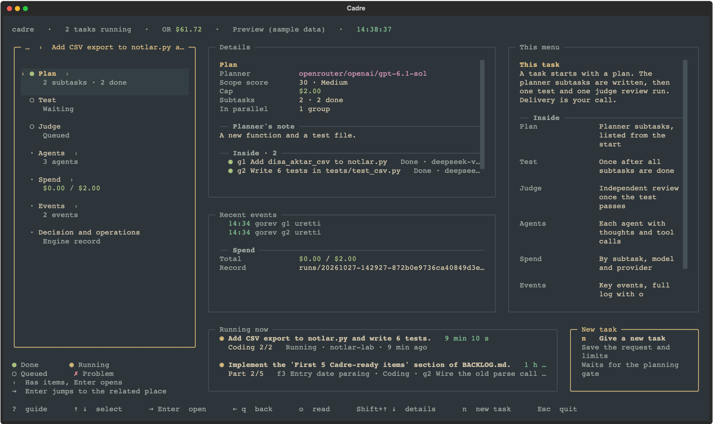
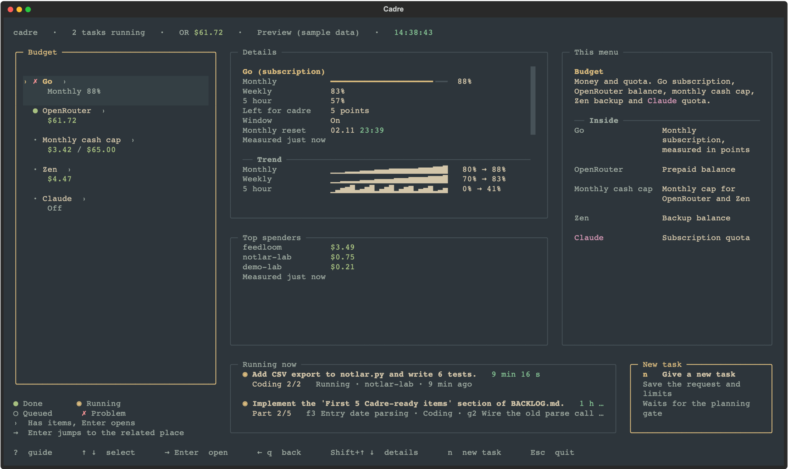

# Cadre

[](https://github.com/BerkayCakibey/cadre/actions/workflows/showcase.yml)

**An experiment in unattended AI coding with a fixed budget, explicit approvals and an independent judge.** Give it a job, a money cap and two approvals. It plans, has the plan reviewed by a separate model session, implements in an isolated git worktree under a per-task macOS sandbox, runs your project's own QA under an evidence observer, asks an independent judge to accept or reject, and records reservations and provider receipts in a ledger. Commit, push and merge remain operator decisions.

Cadre runs on macOS only: the per-task sandbox depends on `sandbox-exec` and `caffeinate`, so Linux and Windows are not supported.

> **In 30 seconds.** Built by one developer in about six weeks (September–October 2026), Cadre delivered a judge-accepted change on a real project for 1.40 USD in 45 minutes. It still needed operator intervention, so the goal of unattended operation remained unproven and development was frozen on 26 October 2026. This showcase records the result, the limits, and the budget and evidence controls worth reusing.
>
> File names and code identifiers are in Turkish. Comments, docstrings and the documentation are in English.



## What it was for, and how it ended

**The goal.** Hand a real coding job to a cheap model, walk away, and come back to a change that an independent judge has verified, inside a fixed budget, without the model ever touching the main branch.

**What worked.**

- **Real accepted work.** On 26 October the engine planned, implemented, tested and got judge acceptance for a source adapter fix on a real project: 20 lines of product code and 301 lines of tests written by the model, 396 tests passing, all five judge criteria met, 1.40 USD and 45 minutes. A narrower verification-only run had passed on 21 October for 0.25 USD.
- **Budget caps held in the recorded runs.** No typed-request run exceeded its cap (53 runs, 45 paid, 7.49 USD in total, at most 44% of a cap used). Every paid call was reserved first and settled by the provider's receipt.
- **Delivery stayed with the operator.** Across all 424 recorded runs the engine pushed or merged nothing; commit, push and merge stayed with the operator.
- **The evidence chain worked.** The judge read the real diff and the engine's own records instead of the model's summary, and deleted or weakened tests are blocked by mechanical gates, not by trust.

**Why it fell short.**

- **It still needed a human.** Every accepted run needed someone to watch, interpret a stop and intervene. On the last day eight runs produced one acceptance; the other seven stopped on engine strictness, a budget estimate that was 2x too low, or operator decisions.
- **The acceptance checks repeatedly stopped correct work.** Live runs kept exposing fail-closed checks that needed engine fixes or operator decisions. Each fix was small and tested, but the pattern did not end.
- **An economic advantage was not demonstrated.** The accepted job cost 1.40 USD, or 2.64 USD counting two earlier failed attempts, plus supervision. There was no measured comparison with an interactive subscription assistant.

So development stopped and the repository was published as a record. The full account with all numbers is in [STORY.md](STORY.md); [CONTINUATION.md](CONTINUATION.md) lists what to do next if you want to take it further.

**The main lesson.** Measure cost, time and operator intervention on a few real jobs before expanding providers, job types and acceptance rules. The scope grew before a repeatable unattended path had been demonstrated.

## Ideas worth taking

The most reusable parts are the budget, approval and evidence controls:

- A money cap enforced from a ledger with real provider receipts: a reservation before every paid call, settled by the receipt after it; a broken stream keeps its reservation.
- Two-step typed approval that pins the source digest, the QA command hash and the model route before any paid call.
- A per-task sandbox with scoped writes, configured read roots, network denial and known credential-path checks. Its boundaries are documented in [SECURITY.md](SECURITY.md).
- A QA observer that records which tests were collected and executed, treats weakened lint as unverified, and allows test deletion only through a recorded operator decision.
- An independent judge bound to the product revision digest, answering criterion by criterion with evidence instead of prose.

## Code tour

These entry points implement the main controls. File names and identifiers are Turkish; comments, docstrings and all documentation are English.

| Where | What it shows |
| --- | --- |
| [`BudgetLedger.reserve`](engine/lib/butce_kapisi.py#L1429) and [`settle`](engine/lib/butce_kapisi.py#L1536) | The money cap: reserve the worst case before a call, settle with the provider receipt after it |
| [`approve`](engine/lib/izin.py#L178) | Two separate typed approvals bound to one exact action |
| [`project_tool_policy`](engine/lib/oturum.py#L418) | The per-task `sandbox-exec` profile built from the plan |
| [`silinen_testler`](engine/lib/kabul.py#L1204) and [`zayiflatilan_testler`](engine/lib/kabul.py#L1389) | Mechanical gates for deleted and weakened tests |
| [`kanit_paketi`](engine/lib/kabul.py#L2348) | The evidence core the judge receives |
| [`parse_review`](engine/lib/sonuc.py#L304) and [`decision`](engine/lib/sonuc.py#L368) | Strict parsing of the judge's answer and the single acceptance predicate |

## What it does

- **Fixed money, before anything runs.** A typed request becomes a proposal that pins the source digest, the QA command hash, the model route per role and a cap in USD. Two separate operator approvals unlock paid calls; the cap of a typed request never moves during the run.
- **Plan, then an independent review of the plan.** A planner model writes a measurable plan. A separate clean session reviews it against the original request. One bounded automatic correction, then the operator decides.
- **Sandboxed implementation.** The job runs in its own git worktree. The model gets a confined shell and a to-do list, nothing else; every command runs under a per-task `sandbox-exec` profile that allows writes only to the files named in the plan (the QA repair round may write anywhere in the worktree), restricts reads to configured roots, denies the network and known credential paths, and blocks package installers. The read roots include system directories and interpreter locations; their limits are listed in [SECURITY.md](SECURITY.md).
- **QA with evidence, not claims.** Your project's format, lint, type and test commands run under an observer that records which tests were collected and executed. Lint weakened by flags counts as unverified. A deleted or weakened test blocks acceptance unless the operator records an explicit test-maintenance decision.
- **An independent judge.** A separate model session receives the real diff and the engine's structural evidence and must answer criterion by criterion. A verdict without evidence is rejected.
- **A ledger you can audit.** Reservations, receipts and provider costs per role and per run, with recovery for stale reservations. Commit, push and merge stay operator decisions with two typed answers each.

## How it works

```
request ──► proposal (source digest · QA hash · models · cap)
        ──► approval 1 ──► approval 2
        ──► plan (planner) ──► independent plan review ──► one bounded correction
        ──► implementation in isolated worktree, per-task sandbox
        ──► project QA under evidence observer (format · lint · type · tests)
        ──► independent judge (diff + structural evidence, criterion by criterion)
        ──► ledger (reservations · receipts) ──► delivery only by operator command
```

Every stop is recorded with a reason code; the operator continues with a recorded decision (`plan-change`, `plan-resume`, `test-maintenance`, `request-plan`), never with free text. See [docs/ARCHITECTURE.md](docs/ARCHITECTURE.md).



## Try it without paid calls

```bash
mkdir -p .tmp && make test-fast     # 385 Python + 69 Node tests, no provider, no venv; about 2 minutes on Apple Silicon, 8 to 14 minutes on hosted macOS runners
```

With [Textual](https://textual.textualize.io/) 8 installed, `CADRE_DIL=en python3 engine/lib/arayuz.py --ornek` opens the panel shown above on sample data in a temporary home; it makes no model calls. Then read [examples/rcfix004-v3e/](examples/rcfix004-v3e/): the full record of one accepted run, from request to ledger.

Installing the engine is optional and changes files outside this repository. `python3 engine/lib/kurulum_kontrol.py` checks the prerequisites first without installing anything. `./sync.sh push` copies the engine to `CADRE_HOME` (default `~/.local/share/cadre-engineering`), writes a `cadre` launcher to `CADRE_BIN_DIR` (default `~/.local/bin`), writes agents, skills, commands and `AGENTS.md` into `OPENCODE_CFG` (default `~/.config/opencode`; existing files it did not write stop the push until you `adopt` them), and restarts the background guards if they are running. The launcher remembers the chosen `CADRE_HOME` and `OPENCODE_CFG`. Point those variables at a throwaway location first; `./sync.sh plan` shows what would change. Prerequisites: macOS, Git, Bash, Python 3.12+, Node 22+, the OpenCode CLI 1.18.x with your provider keys configured locally; see [docs/INSTALL.md](docs/INSTALL.md). After installing:

```bash
cadre kurulum-kontrol               # read-only prerequisite check, installs nothing
cadre init ~/code/your-project      # register a project (no commit, no model call)
cadre istek < request.json          # typed request; prints the run id, waits at the planning gate
python3 "${CADRE_HOME:-$HOME/.local/share/cadre-engineering}/lib/kosu.py" request-proposal <RUN_ID>
```

For `request.json`, start from `examples/rcfix004-v3e/1-request.json`: set a new `submission_id`, your `project` and `target_path`, the scope fields, and add a `prompt` (the example omits its prompt). The proposal prints the pinned source, QA command, models and cap. Nothing has been spent. Two `request-approve` steps and `start` would begin the paid run; `cadre izle` follows it live and `cadre verim <RUN_ID>` breaks down cost and time afterwards. Every command is described in [engine/USAGE.md](engine/USAGE.md).

## What is inside

| Path | Content |
| --- | --- |
| `engine/lib/` | 49 Python modules (run store, budget ledger, routing, sandbox session, dispatcher helpers, acceptance, judge parsing, panel) |
| `engine/bin/` | dispatcher, config-integrity guard, health and quota guards |
| `engine/tests/` | 101 modules, 1,974 Python and 97 Node tests; `engine/tests/regression.sh` is the full gate, see [docs/TESTING.md](docs/TESTING.md) |
| `engine/USAGE.md` | the CLI and operations reference |
| `config/` | agent instructions (plan, review, implementation), sample OpenCode config |
| `docs/` | architecture, install, testing, panel screenshots |
| `examples/rcfix004-v3e/` | the edited record of the first end-to-end acceptance (request, proposal, plan, review, QA, judge, outcome, ledger summary) |
| `sync.sh` | manifest-based transfer between this repository and the runtime home |

Runtime data (runs, reports, ledgers) lives in `~/.local/share/cadre-engineering`, never in the repository.

## Limits, stated plainly

- macOS only (`sandbox-exec`, `caffeinate`); Apple has deprecated `sandbox-exec`.
- OpenCode 1.18.x and its V1 plugin API; newer OpenCode releases need a migration.
- Code identifiers, CLI command names, JSON field names, runtime messages and the recorded model answers used as test fixtures are Turkish. Documents, comments, docstrings, the CLI reference and the agent instructions are English, and the panel has an English mode. A short glossary is in [docs/ARCHITECTURE.md](docs/ARCHITECTURE.md#glossary).
- The full test gate takes about 15 minutes on an idle machine and is sensitive to load; one QA module needs an external Python with pytest, Ruff and BasedPyright.
- The recorded runs did not establish an economic advantage over interactive subscription assistants. The reusable outputs are the audit trail, budget controls and evidence checks.

## Read next

[STORY.md](STORY.md) · [CONTINUATION.md](CONTINUATION.md) · [docs/ARCHITECTURE.md](docs/ARCHITECTURE.md) · [docs/INSTALL.md](docs/INSTALL.md) · [docs/TESTING.md](docs/TESTING.md) · [SECURITY.md](SECURITY.md)

MIT License. Built by one developer with Claude and Codex as pair programmers, on and off, between September and October 2026.

Berkay Cakibey · [berkaycakibey.com](https://berkaycakibey.com) · hello@berkaycakibey.com
